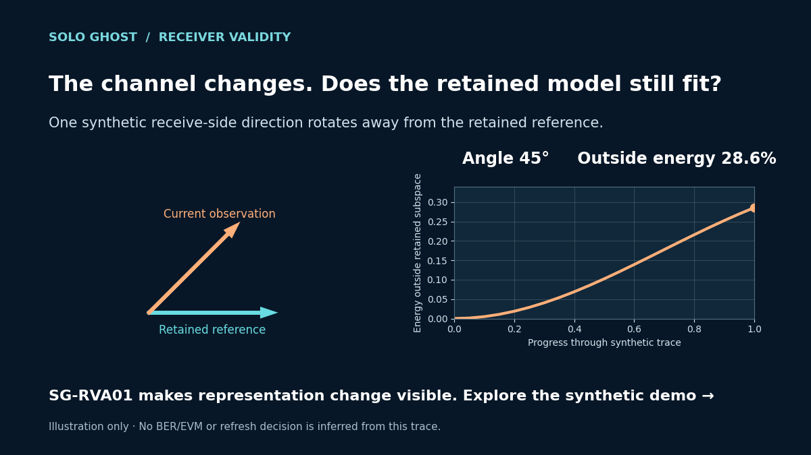

# When does a retained channel representation stop fitting?



This **synthetic educational example** generates a 4 × 4 rank-2 channel trace. One receive-side direction rotates by 0° to 45° across 21 snapshots. It computes the largest principal angle between the current and reference left singular subspaces, and the fraction of current channel energy outside the retained reference subspace.

At the final snapshot the angle is 45° and the outside-energy fraction is 0.2855. These are construction-specific geometry diagnostics. They do not establish BER/EVM degradation, a refresh threshold, or a receiver-performance gain.

## Run

```powershell
python -m pip install -r requirements.txt
python angle_example.py
```

The script writes `synthetic_angle_and_leakage.png`. It needs NumPy and Matplotlib and has no customer-data input. Its calculation convention is receive-side (left singular vectors), rank 2, with the first snapshot fixed as reference.

[See the short animated explanation](assets/receiver_validity_loop.gif).

SG-RVA01's public interactive demonstration uses synthetic channel data. Add its actual hosted URL here after deployment.
